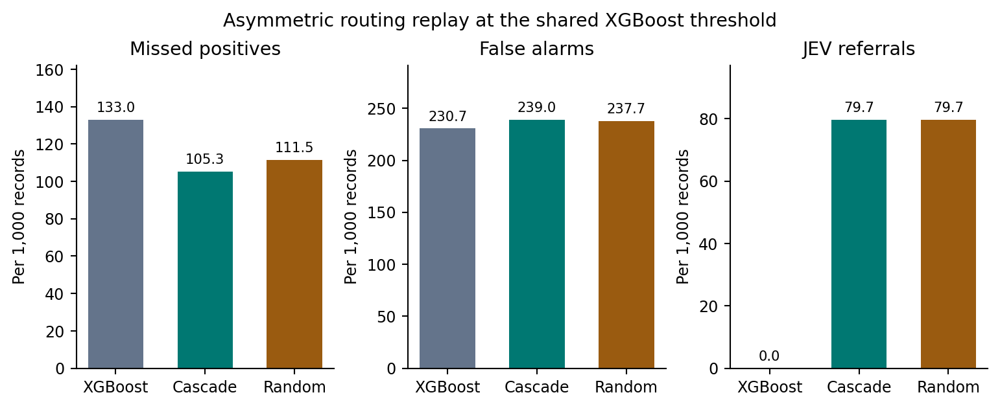
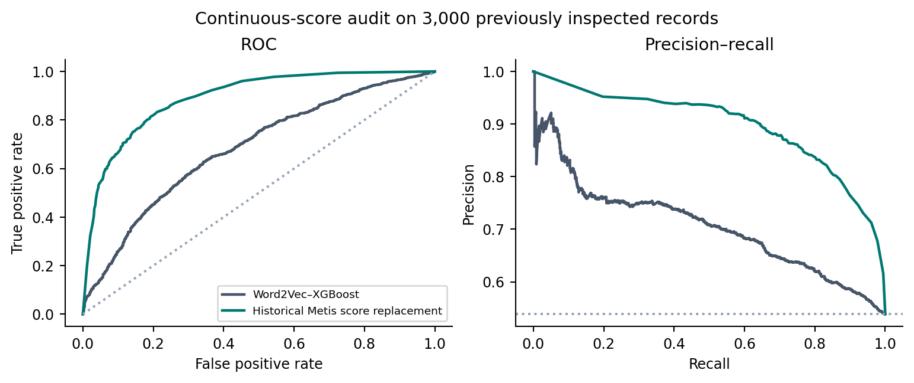

# Asymmetric referral for suicide-related text classification

**Supervisor revision**

**Negar Forouzan affiliation.** Pending confirmation of official institutional name.

## Abstract

An original-validation threshold of **0.45** was selected for Word2Vec–XGBoost with Youden’s J. The asymmetric cascade keeps every positive comparator decision and refers only comparator negatives with scores in **[0.40, 0.45)**. On 3,000 previously inspected text records, it recovered **83 positive labels**, added **25 false alarms**, and required **239 prospective requests**. Recall increased from 75.31% to 80.45%. These results are exploratory. Fresh evaluation and its population-level random comparator are pending in the delivered snapshot.

## 1. Model identity and reference labels

The recorded service is **Metis Jev API**, called with provider alias **`jev-latest`**. The archived inference window was 2026-10-21, 22:37:43 to 22:59:07 Tehran time. The provider’s immutable backend version, architecture and parameter count are unavailable. Requests use generation defaults, parse `answers.department.score`, and count failures without automatic retries. The endpoint, exact scoring instructions and prompt hash are in `model_and_api.json`. “Perplexity Decider” is an undocumented name from the earlier report and has been removed from the comparisons. Candidate open-weight models remain untested.

The repository identifies Kaggle `nikhileswarkomati/suicide-watch` version 14. The full dataset checksum is in `reproducibility.json`. The input is one exported text record. The source pipeline maps the supplied CSV `class` to `suicide=1` or `non-suicide=0`. The possible Reddit and subreddit origin, expert participation, post or author annotation unit and linkage to IEEE document 9591887 require primary-source verification. A subreddit-derived label, if confirmed, measures source membership used as a content proxy. The observed outcome is the supplied text-record label. [Dataset release](https://www.kaggle.com/datasets/nikhileswarkomati/suicide-watch) · [IEEE source supplied by the project owner](https://ieeexplore.ieee.org/document/9591887)

## 2. Comparator and referral rule

Table 1 identifies every cutoff discussed in the feedback. The 0.38 entry is the rounded F1 threshold identifiable in the archived development output. The earlier standalone PDF was unavailable for a cell-by-cell comparison.

**Table 1. XGBoost threshold provenance.**

| Cutoff | Selection data and criterion | Role |
|:---|:---|:---|
| 0.383297 | 2,000 cached development records, maximum F1 | Earlier exploratory baseline, shown as 0.38 |
| 0.44 | Original validation, maximum F1 on the original grid | Centralized notebook’s historical tuned baseline |
| 0.50 | Fixed cutoff specified before historical comparison | Historical replacement and OR accounting |
| **0.45** | **Original validation, maximum Youden’s J on 0.05 edges** | **Shared cutoff for the revised comparator and cascade** |

The original validation histogram contains 37,086 records. At the archived 0.50 decision, bin errors below 0.50 are positives and bin errors above or at 0.50 are negatives. This recovers the confusion matrix at every eligible 0.05 edge exactly. The rule maximizes sensitivity + specificity − 1, with ties resolved by higher sensitivity and then higher cutoff. The selected validation confusion counts are TP 17,376, FP 1,650, FN 1,185 and TN 16,875. Validation precision is 0.913, recall 0.936, F1 0.925, and Youden’s J 0.8471. A finer optimum cannot be inferred from this histogram.

The 51.41% historical error peak in [0.45, 0.50) concerns the 0.50 comparator. These records are **positive** at the revised 0.45 threshold. The validation errors at the historical outer edges are 27.52% for [0.25, 0.30) and 25.93% for [0.75, 0.80). Maximizing the number of possible referrals would mix regions with different error profiles. Under the revised policy, candidate intervals end at 0.45. Intervals starting below 0.25 lack archived JEV scores. On the 2,000-record cached development split, supported intervals and sigmoid decision cutoffs were compared by F2 improvement per referral with a minimum of 100 available referral records. Five-fold cross-fitting used the supplied label as the calibration target. The final sigmoid is fitted on successful historical development responses within the comparator-negative coverage. The chosen routing interval is [0.40, 0.45), with a calibrated score cutoff of 0.40. Neither the raw score nor this cutoff specifies an individual’s clinical risk.

For XGBoost score `p`, the comparator is positive when `p >= 0.45`. Refer only `p` in `[0.40, 0.45)`. A successful JEV decision can add a positive flag. A failed or unavailable response retains the comparator outcome. This add-only rule preserves all comparator detections and can increase false alarms. The primary effectiveness question is the sensitivity gain and accompanying false alarms at fixed request volume.

## 3. Historical results and paired statistics

Table 2 shows the 3,000-record cache replay. All policies use the same XGBoost cutoff and denominator. The random policy refers uniformly among the observed comparator negatives and uses the identical JEV decision. The equal budgets are expected policy counts on the cache. Precision for the random policy is the ratio of expected confusion totals.

**Table 2. Exploratory policy metrics at a shared XGBoost threshold.**

| Policy | Precision | Recall | F1 | F2 | Requests |
| --- | ---: | ---: | ---: | ---: | ---: |
| Word2Vec–XGBoost | 0.638 | 0.753 | 0.690 | 0.727 | 0 |
| Asymmetric cascade | 0.645 | 0.804 | 0.716 | 0.766 | 239 |
| Equal-budget random referral | 0.642 | 0.793 | 0.710 | 0.757 | 239 |

**Table 3. Confusion counts, with expected counts for random referral.**

| Policy | TP | FP | FN | TN |
| --- | ---: | ---: | ---: | ---: |
| Word2Vec–XGBoost | 1,217 | 692 | 399 | 692 |
| Asymmetric cascade | 1,300 | 717 | 316 | 667 |
| Equal-budget random referral | 1,281.4 | 713.0 | 334.6 | 671.0 |

The cascade’s sensitivity difference against XGBoost was +5.14 percentage points (paired row-bootstrap 95% interval +4.08 to +6.24). Per 1,000 records the cascade added 8.33 false alarms and recovered 27.67 missed positive labels. Against expected random referral within cached negatives, the recall difference was +1.15 points (95% interval +0.25 to +2.14). The difference in false alarms was +1.32 per 1,000 (95% interval -1.46 to +4.25). Those comparisons condition on the observed score-range cache and its fitted policy. They cannot establish the same advantage among all comparator negatives.

The exact McNemar table includes overall errors, sensitivity on positive labels, and specificity on negative labels for the two deterministic rules. Counts and p-values are in `mcnemar.json`. Author clusters are unavailable, so the tests and paired intervals assume record independence for descriptive inference. Population sampling and expected-random totals use paired stratified intervals during fresh replay. The results are associated with dataset labels and previous examination of the cache.

As a historical check, OR at the old 0.50 thresholds would have referred 2,184 of 5,000 cached records, recovered 538 positives and added 96 false alarms. Applying these exact changes only to the historical selected rows and retaining the 0.50 comparator for the rest gives a full-test replay sensitivity of 94.41% versus 92.09% base. The historical replacement that reduced false alarms from 953 to 248 also lost 511 correctly detected positive labels. It is a secondary audit of the earlier design.

### Score ranking and calibration

For the same cached records, the continuous historical Metis score with XGBoost fallback and the continuous XGBoost score support paired DeLong analysis. The paired ROC-AUC difference was +0.209 (95% interval +0.189 to +0.229). Tied ratings receive midrank credit. Binary cascade and expected-random decisions are evaluated at their frozen operating point. PR-AUC below uses trapezoidal integration. Average precision uses the step-weighted definition.

| Score | ROC-AUC | PR-AUC | Average precision |
| --- | ---: | ---: | ---: |
| Word2Vec–XGBoost | 0.682 | 0.705 | 0.705 |
| Historical Metis score replacement | 0.891 | 0.897 | 0.890 |

For 1,090 successful held-out ratings among cached comparator negatives, Brier loss changes from 0.149 to 0.128; log loss changes from 0.591 to 0.399. Calibration applies to this supplied label under this score-region distribution. The verified response field exposes a scalar rating. Token logits and log-probabilities are unavailable in the export. The protocol specifies a qualitative alternative for a separately validated model and corpus.

## 4. Prospective evaluation and independence

The original test includes 46,342 records and 6,067 in the old interval. Of the 1,067 outside the old 5,000-record study, 5 were already selected in the error study. After those known exclusions, 1,062 records could remain in the original interval and 41,323 in the original test frame before further exclusions. The size of the new [0.40, 0.45) stratum requires complete original scores. The 3,000-record archive replay is evaluation-disjoint from the new fit, but all 5,000 were previously inspected. The residual test is previously unqueried at the record level after exclusions and previously reported in aggregate. A genuinely independent sample must come from an untouched source or time/author cohort.

The frozen residual-study design samples other comparator negatives from the full remaining test frame as random-referral controls. It uses the full reviewed stratum, all comparator positives for local scoring, and one response per sampled comparator negative. Probability weights recover the residual population. Both assisted policies use the same eligible decision and the same population request count. Protocol, model, manifest and reference hashes are sealed before opening evaluation outcomes. Reviewers can audit this method without spending the 10,000-attempt ceiling. All-text dispatch serves as a cost reference only.

Fresh sample status: **fresh sample not frozen**. The Study 2 ledger shows 0 attempted calls and 10,000 remaining. The inspected environment returned proxy CONNECT 403 for Metis, Kaggle and IEEE, and the complete private score and text frames are absent. The exact dataset-label provenance and applicable transfer terms are still unresolved.

## 5. Computational accounting and local models

Word2Vec averages a compact skip-gram representation and the CPU XGBoost scorer is retained as a lightweight baseline. Averaging loses much of the order and context used for negation, quotation, temporal reference, and expressions of intent. A local word and character TF-IDF logistic regression comparator uses the same upstream splits and Youden criterion. Benchmark commands time each model’s full warm text-to-score path on original validation texts and record observed process RSS.

The real-data TF-IDF and end-to-end resource benchmarks await the original training and validation texts.

The archived XGBoost scoring batch took 0.134 seconds for 46,342 pre-tokenized records, equivalent to 0.002895 seconds per 1,000 in that batch. This measures the embedding and scoring paths only. Archived Metis collection took 1001.7 active wall seconds for 5,000 attempts with concurrent workers. Dividing group wall time by attempts reports batch throughput. Single-request timing and RSS were not retained in those exports.

The cache replay estimates **79.7** referrals per 1,000 for the cascade and equally many for its random comparator; all-referral would require **1,000**. This is a 92.0% request reduction in this cache, with actual paid attempts recorded separately in `fresh_status.json`. Input and output tokens and verified USD charges are unavailable. USD per 1,000 should be derived from measured token usage and rate-card prices for the relevant request mix. Token, latency and cost reductions need their own measurements.

## 6. Conclusion

The revised architecture protects the tuned comparator’s positive decisions and uses a supported, development-selected uncertainty interval. Archived evidence supports studying the sensitivity and false-alarm trade-off under a lower request budget. Fresh evaluation against verified dataset labels is needed to estimate the population benefit over equal-budget random referral. Clinical claims require a reference and population that measure the clinical target.
